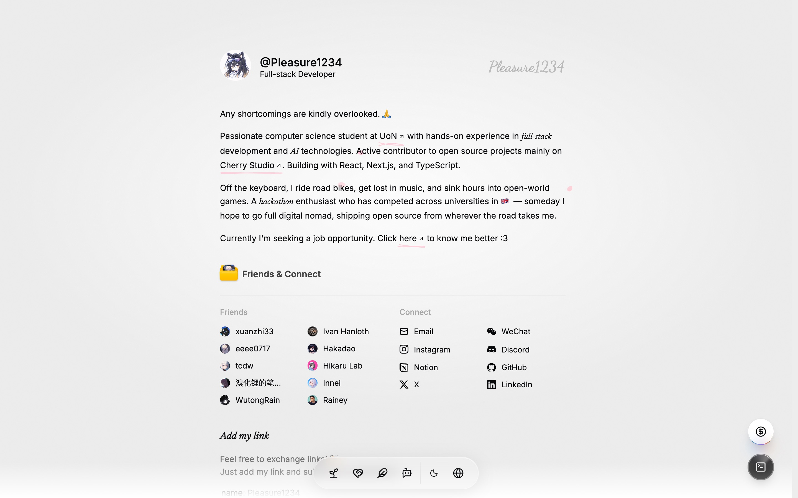

<div align="center">
  <h1>you-find.me</h1>
  <p>A personal site, and the one sign-in for everything else.</p>
  <p><a href="https://you-find.me">you-find.me</a></p>
</div>

<picture>
  <source media="(prefers-color-scheme: dark)" srcset="docs/assets/screenshot-dark.jpg">
  
</picture>

## Features

- **Home, Story and CV** — who I am and what I build, in three languages
- **Chat and Terminal** — a Pi Agent chat and a slash-command terminal
- **Gateway** — the OAuth issuer behind every Vesper app and site

## Develop

```sh
pnpm install
pnpm dev
```

React and Hono on Cloudflare Workers with Void and Better Auth ·
[Architecture](docs/ARCHITECTURE.md) · [Deployment](docs/DEPLOYMENT.md)

AGPL-3.0, with code derived from [Taki](https://github.com/canmi21/taki) · Part of [Vesper](https://github.com/vesper-shop)
